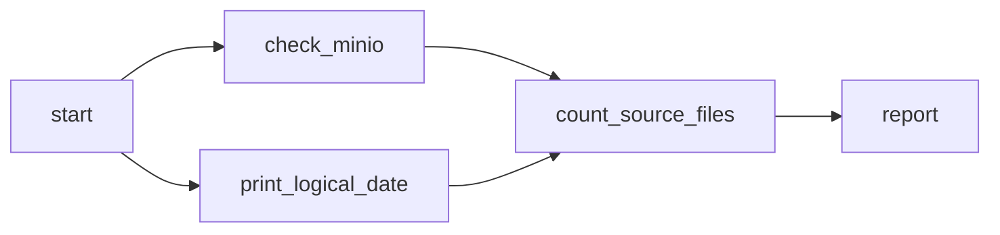
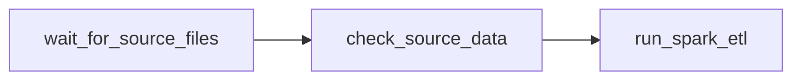

# Airflow

Two DAG files are bind-mounted to `/opt/airflow/dags`. The scheduler re-reads that folder about every 30 seconds. Both DAGs are **paused**.

`dags/urbangear_hello.py` is a small DAG for learning how Airflow runs work. It does not call `etl_job.py`. `dags/urbangear_daily_sales_pipeline.py` waits for a day's raw file and runs that Spark job. The quality gate, the warehouse load, and the dbt task are still later labs.

## What each Airflow process does

| Process | Role |
|---|---|
| `airflow-scheduler` | Imports the DAG file, decides which runs are due, queues tasks, and applies retries. |
| `airflow-webserver` | The UI at http://localhost:8080 (`admin` / `admin`). |
| `airflow-db` | Stores every run, task state, connection, and XCom. Analysts do not query it. |

The DAG file is a description. Importing it must stay cheap, because the scheduler imports it over and over. The real work sits inside the tasks.

## The run and the date inside it

`schedule="@daily"` with `start_date` of 1 July 2026 means one run per day, at 00:00 UTC. `catchup=False` means turning the DAG on creates only the latest closed day, not one run for every day since July.

A daily run's logical date is the day whose data it processes. That run starts after the day has ended. Inside the tasks, `{{ ds }}` in a Bash command and `context["ds"]` in Python are that logical date. That is the value `etl_job.py` will receive as `--process_date`.

`default_args` applies to every task: owner `data-engineering`, 2 retries (3 attempts), 1 minute between retries, a 10-minute `execution_timeout`, and `_alert`. The callback prints `[ALERT]` once, on the last failed attempt. A later lab sends that line to Slack.

## The five tasks



`start` is an `EmptyOperator`. It does nothing and makes the graph's first node obvious. `check_minio` curls MinIO's live health URL. `print_logical_date` echoes `{{ ds }}`. `count_source_files` lists `raw/orders/dt=<ds>/` in the bucket and returns the number of objects. `report` reads that number with `xcom_pull`. XCom is for a small value such as a count. The order lines themselves stay in the lake.

`start >> [check_minio, print_date] >> count_files >> report` runs the health check and the date echo together. Both have to succeed before the count. If the health check fails its last retry, the count and the report are marked `upstream_failed` and do not run.

## What a run showed

```bash
MSYS_NO_PATHCONV=1 docker exec airflow-scheduler airflow dags list-import-errors
MSYS_NO_PATHCONV=1 docker exec airflow-scheduler airflow dags test urbangear_hello 2026-07-01
```

`list-import-errors` prints `No data found`. The test run prints `MINIO_OK`, `processing data interval starting 2026-07-01`, `[COUNT] 1 file(s) under raw/orders/dt=2026-07-01/`, `[REPORT] date=2026-07-01 files=1`, and `state=success`.

A scheduler trigger with logical date 2026-07-02 wrote the same report for 2 July, and the XCom key `return_value` on `count_source_files` is `1`. Turning the DAG on also created the latest closed day, 2026-11-10. That run succeeded with `[COUNT] 0 file(s)`, because the lake has no file for that date.

`airflow dags next-execution urbangear_hello` prints a timestamp at `00:00:00+00:00`. That timestamp is the logical date. The run is created after the interval closes, one day later. The guided lab's real DAG will use `0 4 * * *` so the morning run starts at 04:00 UTC, after the export has had time to land.

Pointing `check_minio` at port 9999 made the task `up_for_retry` and then `failed` on attempt 3. The attempt 3 log ends with:

```text
[ALERT] task=check_minio date=2026-07-03 FAILED. Log: http://localhost:8080/...
```

`count_source_files` and `report` became `upstream_failed`. Restoring port 9000 and clearing the 2026-07-03 task instances ran the health check again. Attempt 4 printed `MINIO_OK`, and the report printed `[REPORT] date=2026-07-03 files=1`. The DAG was paused again after that.

## Daily sales DAG

`dags/urbangear_daily_sales_pipeline.py` is the start of the real pipeline. The schedule is `0 4 * * *`, so a run's logical time is 04:00 UTC. `catchup=False` stops the scheduler from creating one run per day since July on its own. `max_active_runs=1` keeps two days from running at once. `DEFAULT_ARGS` gives every task 3 retries, 10 minutes apart, a 2-hour timeout, and `_failure_alert`. That callback prints `[ALERT]`. If `SLACK_WEBHOOK_URL` is set, it also posts the same text.

Credentials for MinIO live in the Airflow connection `aws_default`, not in the DAG. The DAG only names the connection id. Recreate it with:

```bash
MSYS_NO_PATHCONV=1 docker exec airflow-scheduler airflow connections add aws_default \
  --conn-uri 'aws://minioadmin:minioadmin123@/?endpoint_url=http%3A%2F%2Fminio%3A9000'
```

The extra `endpoint_url` is `http://minio:9000`. Without it, the S3 client would call real AWS.



`wait_for_source_files` is an `S3KeySensor` for `raw/orders/dt={{ ds }}/part-*.json`. `wildcard_match=True` is required, because the key contains `*`. It checks every 5 minutes for up to an hour. `mode="reschedule"` gives the worker slot back between checks. `retries=0` on this task, so a timeout alerts immediately instead of waiting another hour.

`check_source_data` lists that prefix with `S3Hook` and pushes `source_file_count`. An empty prefix raises `FileNotFoundError`. A test for 9 July does that. A test for 1 July returns `1`.

`run_spark_etl` is `spark-submit --master local[2]` of `jobs/etl_job.py --process_date {{ ds }}`. On AWS the same task is a Glue job with the same argument.

A backfill from 1 July through `2026-07-04T04:00:00` finished four runs, 12 tasks, all success. The 4 July Spark log says `Clean: 1,933 | Rejected: 67 | Rate: 3.35%`. The end time has to include 04:00. A bare `2026-07-04` is midnight, which is before that run.

Clearing `run_spark_etl` for 2 July and running it again left `rows 07-02: 1924`. The write overwrites the partition for that logical date, so a second run does not add rows.

A trigger for 6 July found no file. The sensor went `up_for_reschedule` while poking `dt=2026-07-06`. After `generate_orders.py` uploaded that day (2,000 lines, 862,671 bytes), the next check succeeded and Spark logged `Clean: 1,948 | Rejected: 52 | Rate: 2.60%`. Turning the DAG on also created a run for 10 November, which has no file. That run was stopped so it would not hold the single active slot for an hour. The DAG is paused again. 5 July is still unprocessed.
