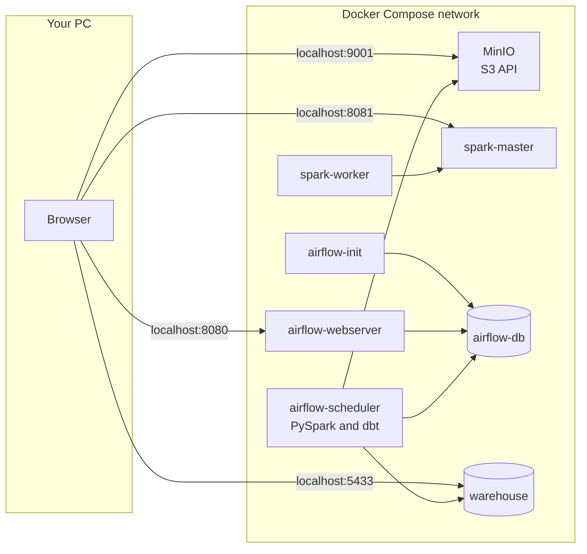
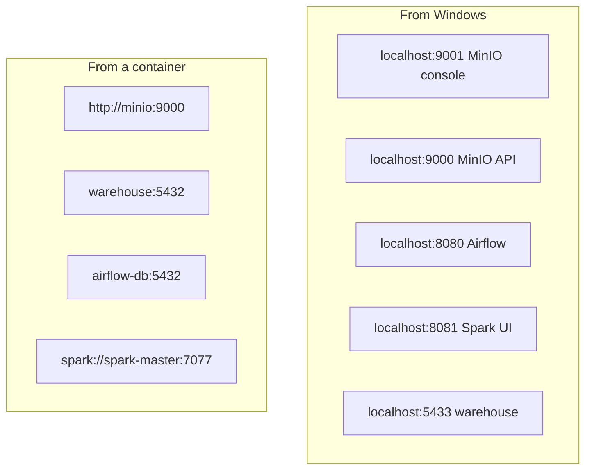
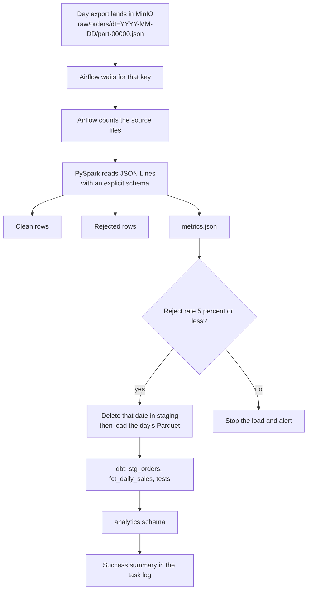
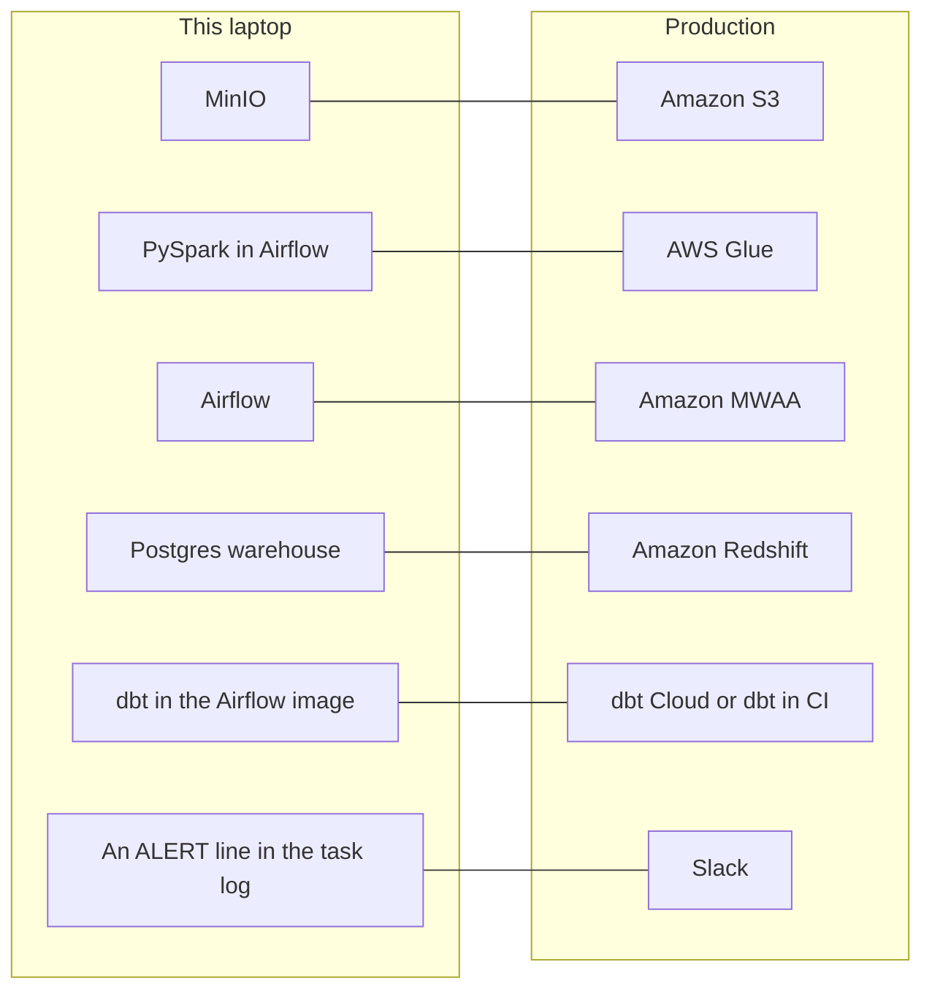

# Architecture

UrbanGear needs yesterday's sales in the dashboard by 9 AM. Orders arrive from three platforms: `website`, `mobile_app`, and `marketplace`. The pipeline waits for the day's export, cleans it, refuses a day that is too dirty, loads a warehouse, and builds the tables analysts read.

Airflow is the only service that decides what runs next. MinIO, Spark, Postgres, and dbt each do one kind of work.

## Platform

Eight containers, defined in `docker-compose.yml`. `airflow-init` runs once and exits. The other seven stay up.

| Container | Image | Role |
|---|---|---|
| `minio` | `bitnamilegacy/minio:2025.4.22` | Object storage. API on 9000, console on 9001. |
| `airflow-db` | `postgres:16` | Airflow metadata: runs, task state, connections. No host port. |
| `warehouse` | `postgres:16` | Analytics database. Host port 5433 maps to 5432 inside the network. |
| `spark-master` | `bitnamilegacy/spark:3.5` | Spark UI and master port 7077. Runs as root so `spark-submit` has a passwd name. See [Spark job](spark.md). |
| `spark-worker` | `bitnamilegacy/spark:3.5` | One worker, 2 cores, 2 GB. Also runs as root, for the same reason. |
| `airflow-init` | `sk03-airflow:2.9.3` | Migrates the Airflow database and creates user `admin`, then exits 0. |
| `airflow-webserver` | `sk03-airflow:2.9.3` | The DAG UI. |
| `airflow-scheduler` | `sk03-airflow:2.9.3` | Runs the tasks. Jobs, Spark, and dbt execute here. |

The Spark master and worker are not on the daily path. Pipeline jobs use a local Spark session inside `airflow-scheduler`. The standalone cluster exists so the Spark UI at http://localhost:8081 shows one alive worker.

`bitnamilegacy` images are frozen: they still download, and they receive no security patches. That is acceptable for this lab.

### What the Airflow image adds

`docker/Dockerfile` starts from `apache/airflow:2.9.3-python3.11` and adds:

- Java 17, because PySpark drives a JVM.
- PySpark 3.5.1.
- `hadoop-aws` and `aws-java-sdk-bundle`, so Spark can read and write `s3a://` paths on MinIO or AWS without downloading JARs at job start.
- dbt Core 1.8.10, dbt-postgres 1.8.2, dbt-adapters 1.16.3, and dbt-common 1.27.1.

The base image is already Airflow 2.9.3. dbt is installed in its own `pip` command so the resolver does not walk Airflow's dependency tree. dbt-postgres 1.8.2 uses `psycopg2-binary`, which that image already contains.

### Two networks, two hostnames

A bind mount makes a project folder appear inside the container. Saving `jobs/etl_job.py` in the editor is enough; the scheduler sees `/opt/airflow/jobs/etl_job.py` immediately.

| Host folder | Inside Airflow |
|---|---|
| `./dags` | `/opt/airflow/dags` |
| `./jobs` | `/opt/airflow/jobs` |
| `./dbt` | `/opt/airflow/dbt` |
| `./logs` | `/opt/airflow/logs` |
| `./plugins` | `/opt/airflow/plugins` |

Named volumes (`minio-data`, `airflow-db-data`, `warehouse-data`) keep buckets and databases across `docker compose stop` and `docker compose down`. `docker compose down -v` deletes them.

## Daily pipeline

This is the target flow. The lake, the warehouse table, and the Spark read-and-route functions exist now. `jobs/etl_job.py` extracts one day, aborts when the file is far too small, and tags every line clean or rejected. It does not yet write Parquet or emit metrics. The DAG, the quality gate, and the dbt models are still later labs. Counts and the flag rules are in [Spark job](spark.md).

| Stage | Who does it | Input | Output |
|---|---|---|---|
| Land | `jobs/generate_orders.py` in this lab; the source system in production | Nothing in the lake | `raw/orders/dt=…/part-00000.json` |
| Wait and count | Airflow | The raw prefix | A file count passed to the next task |
| Transform | PySpark | That day's JSON Lines | Parquet in `processed/` and `rejected/`, plus `metrics/orders/dt=…/metrics.json` |
| Quality gate | Airflow | The metrics object | Continue when `reject_rate` is 5% or less. Otherwise alert and skip the load. |
| Load | Airflow | That day's processed Parquet | `staging.daily_orders`, replaced for that date |
| Transform in SQL | dbt | `staging.daily_orders` | `analytics` marts, then `dbt test` |
| Alert | Airflow task log locally; Slack in production | The run result | Record counts, or the failed task, date, and log link |

July 5 is generated with `--dirty_rate 0.12` so the gate has a day that should stop. The other four days use the default 3% dirt and should pass.

## Local service and the AWS service it stands in for

boto3 talks to MinIO and to S3 with the same calls. `endpoint_url=http://minio:9000` is the switch. Spark uses the `s3a://` scheme for both, via the JARs baked into the image.

Credentials for MinIO and the warehouse are environment variables on the Airflow containers. They are lab values in `docker-compose.yml`. Production reads them from a secrets manager. The Fernet key in that file only encrypts connections stored in the local Airflow database.
