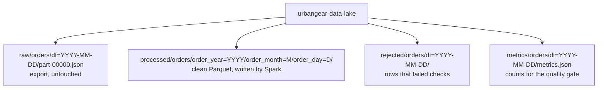

# Data lake

One bucket, `urbangear-data-lake`. Zones are prefixes in the key, not separate buckets and not real folders. The console draws a folder wherever a key contains `/`.



| Zone | Written by | Read by |
|---|---|---|
| `raw/` | `jobs/generate_orders.py` now. The source export in production. | The Spark job, and the Airflow sensor `raw/orders/dt={{ ds }}/part-*.json` |
| `processed/` | Spark, in a later lab | The warehouse load |
| `rejected/` | Spark | People debugging a bad day |
| `metrics/` | Spark | Airflow's quality gate |

Objects are immutable. A rerun replaces `part-00000.json` for that day; it does not append. Listing is a prefix query: every key that starts with `raw/orders/dt=2026-07-01/`. An empty prefix returns no `Contents` key. That is an empty day, not an error. More than 1,000 keys needs a paginator.

`dt=2026-07-01` is Hive-style partitioning (`column=value` in the path). Spark can discover the date from the path.

## Raw file contract

Format is JSON Lines: one JSON object per line, one line per product on an order. An order with three products is three lines that share `order_id`.

| Field | Example | Notes |
|---|---|---|
| `order_id` | `ORD-20260701-00000` | Repeats for each product in the order |
| `customer_id` | `CUST-0241` | Sometimes `null` |
| `platform` | `website` | Valid: `website`, `mobile_app`, `marketplace`. Sometimes padded, such as `" Website "`, or invalid, such as `fax` |
| `order_date` | `2026-07-01T20:05:41` | ISO timestamp. A future date is a bad row |
| `product_id`, `product_name`, `category` | `P100`, `Trail Backpack`, `Bags` | Six products |
| `quantity` | `2` | Sometimes negative |
| `unit_price`, `discount_pct`, `shipping_cost`, `tax_amount` | `89.99`, `10.0`, `11.65`, `14.4` | `discount_pct` is sometimes `null` |
| `payment_method` | `gift_card` | Lower case in the source |
| `shipping_country`, `shipping_state`, `shipping_city` | `US`, `CA`, `Los Angeles` | Country is sometimes lower case |
| `is_returned` | `false` | Boolean |

The generator also truncates some lines so they are not valid JSON. Those five problems are what the Spark job must catch: null customer, negative quantity, future date, invalid platform, corrupt JSON.

## Files already in the bucket

`jobs/setup_buckets.py` creates the bucket. `head_bucket` then `create_bucket` makes a second run print `exists` instead of failing.

`jobs/generate_orders.py` seeds `random.Random` with `f"{process_date}-{dirty_rate}"`. The same arguments always rebuild the same bytes.

| Key | Lines | Bytes | Dirty rate |
|---|---:|---:|---:|
| `raw/orders/dt=2026-07-01/part-00000.json` | 1,968 | 848,812 | 0.03 |
| `raw/orders/dt=2026-07-02/part-00000.json` | 1,989 | 858,532 | 0.03 |
| `raw/orders/dt=2026-07-03/part-00000.json` | 2,004 | 864,842 | 0.03 |
| `raw/orders/dt=2026-07-04/part-00000.json` | 2,000 | 863,405 | 0.03 |
| `raw/orders/dt=2026-07-05/part-00000.json` | 2,004 | 863,182 | 0.12 |

July 1 has 15 corrupt lines. Its first record is order `ORD-20260701-00000`, product Trail Backpack, platform `" Website "`.

Spark agrees. An explicit PERMISSIVE read of that file returns 1,968 lines and, after the DataFrame is cached, 15 corrupt rows. Letting Spark infer the schema instead types `order_date` as a string and `quantity` as `long`. Details are in [Spark job](spark.md).

Each normal day is about 1,000 orders and about 2,000 lines, because each order samples one to three of the six products. July 5 is the day that should fail the 5% quality gate.

Regenerate from the scheduler, where `MINIO_ENDPOINT` is set:

```bash
MSYS_NO_PATHCONV=1 docker exec airflow-scheduler python /opt/airflow/jobs/setup_buckets.py
MSYS_NO_PATHCONV=1 docker exec airflow-scheduler python /opt/airflow/jobs/generate_orders.py --process_date 2026-07-01
MSYS_NO_PATHCONV=1 docker exec airflow-scheduler python /opt/airflow/jobs/generate_orders.py --process_date 2026-07-05 --dirty_rate 0.12
```

The console is http://localhost:9001 (`minioadmin` / `minioadmin123`). MinIO stores the bucket under `/bitnami/minio/data` inside the container. Leave that directory alone. Reads and writes go through the S3 API so MinIO's own metadata stays consistent.
