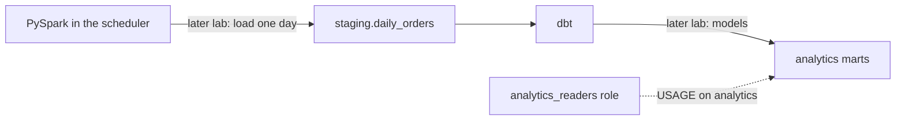

# Warehouse

Postgres 16 in the `warehouse` container is the local stand-in for Amazon Redshift. Analysts and dbt read it. Airflow's own history lives in a different database, `airflow-db`, which has no host port.



`sql/warehouse_init.sql` is mounted into `/docker-entrypoint-initdb.d/`. Postgres runs that directory **once**, when the `warehouse-data` volume is first created. Editing the file later does not re-run it. Apply a change with:

```bash
docker exec -i warehouse psql -U dwh_user -d warehouse < sql/warehouse_init.sql
```

## Schemas

| Schema | Owner | Who writes | Who reads |
|---|---|---|---|
| `staging` | `dwh_user` | The load step, one day's clean order lines | dbt |
| `analytics` | `dwh_user` | dbt marts | Analysts, through role `analytics_readers` |
| `public` | Postgres | Unused by this pipeline | |

`analytics_readers` is a `NOLOGIN` role. dbt's later `post_hook` grants the marts to it. The init script only grants `USAGE` on the schema.

## `staging.daily_orders`

One row per order line, matching the Spark job's clean output. The raw JSON has 17 fields. This table adds the amounts and calendar columns that the job derives.

| Group | Columns |
|---|---|
| From the export | `order_id`, `customer_id`, `platform`, `order_date`, `product_id`, `product_name`, `category`, `quantity`, `unit_price`, `discount_pct`, `shipping_cost`, `tax_amount`, `payment_method`, `shipping_country`, `shipping_state`, `shipping_city`, `is_returned` |
| Money, computed by Spark | `gross_revenue`, `discount_amount`, `net_revenue`, `total_amount` |
| Calendar, computed by Spark | `order_year`, `order_month`, `order_day`, `order_hour`, `day_of_week`, `is_weekend` |
| Order-level, computed by Spark | `order_item_count`, `order_total_revenue`, `is_high_value` |
| Lineage | `etl_processed_at`, `etl_process_date` |

The load step deletes rows for the process date before inserting that day's Parquet. A rerun replaces the day.

The Parquet for 1–4 July is in the lake. This table stays empty until the load lab copies a day in. Confirm the bootstrap with:

```bash
docker exec warehouse psql -U dwh_user -d warehouse -c "\dn"
docker exec warehouse psql -U dwh_user -d warehouse -c "\dt staging.*"
```

Expected: schemas `analytics`, `public`, and `staging`, and relation `staging.daily_orders`.

## Connections

| From | Host | Port | Database | User |
|---|---|---|---|---|
| Windows tools | `localhost` | `5433` | `warehouse` | `dwh_user` |
| Airflow, Spark, dbt | `warehouse` | `5432` | `warehouse` | `dwh_user` |

Password `dwh_pass` is a lab value. Inside Airflow the same settings are `WAREHOUSE_HOST`, `WAREHOUSE_PORT`, `WAREHOUSE_DB`, `WAREHOUSE_USER`, and `WAREHOUSE_PASSWORD`.
